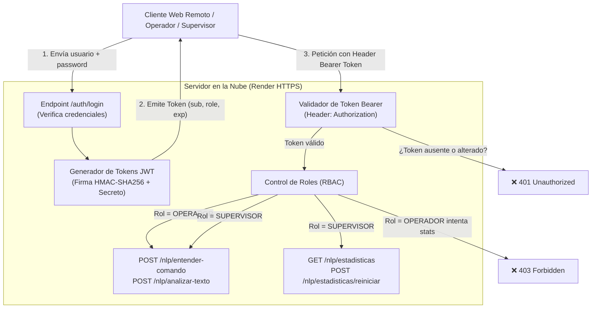

# Documento de Arquitectura Cloud, Investigación y Seguridad
## Extensión: Mini-Azure LUIS v2 en la Nube con Control de Acceso por Roles (RBAC)
**Empresa:** Agroexportadora de la Región de Ica (Uva de mesa y Espárragos)  
**Integrantes:** Integrante A (Investigación Cloud, Despliegue y Seguridad Backend) & Integrante B (Cliente Web, Flujo de Login y Validación)  

---

## 1. Datos Generales de Despliegue y Credenciales de Prueba

* **URL Pública del Servicio (HTTPS):**  
  `https://mini-azure-luis-agroica.onrender.com` *(o host asignado en Render / Koyeb)*
* **Health Check Endpoint:**  
  `GET https://mini-azure-luis-agroica.onrender.com/health`

### Matriz de Credenciales de Demostración:

| Rol de Usuario | Nombre de Usuario | Contraseña | Permisos Concedidos | Restricciones / Prohibiciones |
| :--- | :--- | :--- | :--- | :--- |
| **OPERADOR** | `operador_ica` | `operador2026` | • `POST /nlp/entender-comando`<br>• `POST /nlp/analizar-texto`<br>• Consulta de respuesta inmediata | ❌ **403 Forbidden** al consultar `GET /nlp/estadisticas`<br>❌ **403 Forbidden** al reiniciar `POST /nlp/estadisticas/reiniciar` |
| **SUPERVISOR** | `supervisor_ica` | `supervisor2026` | • Acceso total al Dashboard y KPIs<br>• `GET /nlp/estadisticas`<br>• `POST /nlp/estadisticas/reiniciar`<br>• Todos los endpoints de NLP | Ninguna (Control total operativo) |
| **ANÓNIMO (Sin Login)** | *(Sin token)* | *(Sin token)* | • `GET /` (Interfaz Login)<br>• `GET /health`<br>• `POST /auth/login` | ❌ **401 Unauthorized** en cualquier endpoint de NLP o estadísticas |

---

## 2. Investigación y Selección de Plataforma Cloud Gratuita

Para seleccionar la plataforma óptima se evaluaron 4 opciones líderes del mercado en capas gratuitas (Free Tier) según criterios de compatibilidad con Python/FastAPI, soporte de HTTPS gestionado, facilidad de variables de entorno y límites de cómputo.

### Cuadro Comparativo de Plataformas Evaluadas:

| Criterio Técnico | **Render (render.com)** <br> *(Seleccionada)* | **Hugging Face Spaces** | **Koyeb** | **PythonAnywhere** |
| :--- | :--- | :--- | :--- | :--- |
| **Tipo de Servicio** | PaaS / Web Services | Espacios de Contenedores / App | Serverless CaaS / Micro VM | Hosting Web WSGI |
| **Soporte FastAPI / ASGI** | **Nativo y fluido** vía Uvicorn | Nativo vía Dockerfile / Gradio | Nativo vía Dockerfile / Git | Requiere configuración manual WSGI/Gunicorn |
| **Certificado SSL / HTTPS** | **Automático y gratuito** | Automático (`*.hf.space`) | Automático (`*.koyeb.app`) | Solo en dominio estándar |
| **Gestión de Secretos (.env)** | **Excelente**: Variables de entorno nativas en dashboard | Variables como "Repository Secrets" | Variables de entorno en UI | Archivos locales o script de inicio |
| **Tiempo de Inactividad (Sleep)** | Se suspende tras 15 min de inactividad (Cold start: 30-50s) | Se mantiene activo con tráfico continuo | 1 micro-servicio 24/7 sin sleep | Activo 3 meses (requiere extender en dashboard) |
| **Límites de Recursos** | 512 MB RAM / 0.1 CPU / 750 hrs/mes | 2 vCPU / 16 GB RAM (CPU básica gratis) | 512 MB RAM / 0.1 vCPU | 512 MB disco / Tráfico saliente restringido |

### Justificación de la Elección de Render:
1. **Despliegue Declarativo (Infrastructure as Code):** Render permite usar `render.yaml` (Blueprint), automatizando la instalación de `requirements.txt` y levantando `uvicorn servidor_api_nlp:app --host 0.0.0.0 --port $PORT` con un solo clic desde GitHub.
2. **Compatibilidad Total ASGI:** Soporta WebSockets, HTTP/2 y FastAPI sin capas intermedias complejas.
3. **Por qué se descartaron las otras:**
   * *PythonAnywhere:* Su plan gratuito bloquea peticiones salientes y su soporte para ASGI/Uvicorn es limitado y propenso a fallas.
   * *Hugging Face Spaces:* Está más orientado a demostraciones interactivas de Gradio/Streamlit que a microservicios REST puros con endpoints protegidos por Bearer JWT.
   * *Koyeb:* Aunque excelente, requiere tarjeta de crédito para verificación inicial en algunas regiones.

---

## 3. Arquitectura de Seguridad y Control de Acceso por Roles (RBAC)



---

## 4. Evidencia de Pruebas de Control de Acceso

### (a) Intento de acceso sin autenticación (Rechazo 401 Unauthorized)
* **Petición:** `GET /nlp/estadisticas` (Sin encabezado `Authorization`)
* **Código HTTP:** `401 Unauthorized`
* **Cuerpo de Respuesta:**
```json
{
  "detail": "Acceso no autenticado. Debe proporcionar un token Bearer en el encabezado Authorization."
}
```

### (b) Operación normal del Usuario de Comentarios (OPERADOR)
* **Login:** `POST /auth/login` con `{"username": "operador_ica", "password": "operador2026"}` $\rightarrow$ Recibe Token con `role: "OPERADOR"`.
* **Petición:** `POST /nlp/entender-comando` con encabezado `Authorization: Bearer <TOKEN>`
* **Código HTTP:** `200 OK`
* **Cuerpo de Respuesta:**
```json
{
  "texto_original": "La camara de frio 2 subio a 9 grados con 120 cajas de uva red globe",
  "intencion": "REPORTE_CALIDAD",
  "confianza_intencion": 0.77,
  "sentimiento": "NEGATIVO",
  "entidades": {
    "AREA": "camara de frio 2",
    "PRODUCTO": "uva red globe",
    "CANTIDAD": "120 cajas"
  },
  "accion_sugerida": "ALERTA_CRITICA_CALIDAD",
  "usuario_emisor": "operador_ica"
}
```

### (c) Restricción del Dashboard para el Usuario de Comentarios (Bloqueo 403 Forbidden)
* **Petición:** `GET /nlp/estadisticas` con el token de `operador_ica`
* **Código HTTP:** `403 Forbidden`
* **Cuerpo de Respuesta:**
```json
{
  "detail": "Acceso denegado (403 Forbidden): Su rol 'OPERADOR' no tiene permisos para esta acción. Roles requeridos: ['SUPERVISOR']."
}
```
* **Comportamiento en UI:** En la interfaz web, las tarjetas de KPIs, los gráficos de intención/sentimiento y la tabla general de la planta se ocultan automáticamente, mostrando un banner informativo en ámbar indicando que su perfil solo está habilitado para el envío de reportes.

### (d) Acceso Completo al Dashboard para el Usuario SUPERVISOR
* **Login:** `POST /auth/login` con `{"username": "supervisor_ica", "password": "supervisor2026"}` $\rightarrow$ Recibe Token con `role: "SUPERVISOR"`.
* **Petición:** `GET /nlp/estadisticas` con el token de `supervisor_ica`
* **Código HTTP:** `200 OK`
* **Cuerpo de Respuesta:**
```json
{
  "total_mensajes": 6,
  "por_intencion": {
    "REPORTE_CALIDAD": 1,
    "FALLA_EQUIPO": 2,
    "CONSULTA_INVENTARIO": 1,
    "SOLICITUD_DESPACHO": 1,
    "INTENCION_NO_CLARA": 1
  },
  "por_sentimiento": {
    "POSITIVO": 0,
    "NEUTRAL": 3,
    "NEGATIVO": 3
  },
  "confianza_promedio": 0.782,
  "tasa_derivacion": 0.167,
  "entidades_frecuentes": {
    "AREA: camara de frio 2": 1,
    "PRODUCTO: uva red globe": 1
  },
  "alertas_criticas": 2,
  "ultimos_mensajes": [...]
}
```

---

## 5. Análisis Técnico: Despliegue Cloud vs. Local y Seguridad (1 Página)

### 5.1 Diferencias Operativas frente al Despliegue Local en LAN
1. **Accesibilidad Geográfica y Ubicuidad:** En el laboratorio (LAN), el sistema dependía de que ambas computadoras estuvieran conectadas al mismo switch o router. En el despliegue cloud, cualquier supervisor o personal de campo con conexión 4G/5G en los fundos de Villacurí, Los Aquijes o Paracas puede interactuar con el sistema sin estar físicamente en la planta.
2. **Cifrado en Tránsito (HTTPS):** Mientras que en la red local el tráfico HTTP viajaba en texto plano por el puerto 8001 (vulnerable a intercepción con herramientas tipo Wireshark en la red interna), en Render todo el tráfico está forzado bajo **TLS/SSL (HTTPS)** con certificados gestionados automáticamente.

### 5.2 Riesgos de Seguridad Mitigados con el Control de Acceso por Roles (RBAC)
* **Prevención de Exposición de Información Comercial Sensible:** Un operario de campo no debe tener visibilidad sobre el volumen total de fruta procesada, tasas de rechazo globales ni alertas críticas de otras áreas de la agroexportadora. RBAC asegura que el rol `OPERADOR` solo interactúe con el canal de entrada.
* **Protección contra Sabotaje o Pérdida de Métricas:** El endpoint `POST /nlp/estadisticas/reiniciar` tiene el potencial de borrar todo el historial acumulado de la jornada. Al restringirlo únicamente al rol `SUPERVISOR`, se evita que usuarios no autorizados eliminen la trazabilidad operativa.
* **Trazabilidad por Mensaje (`usuario_emisor`):** Cada reporte procesado guarda en su metadata el nombre del usuario que lo emitió a partir del claim `sub` del token, impidiendo el repudio de incidencias críticas.
* **Gestión Segura de Secretos:** La clave `SECRET_KEY` y las contraseñas no están incrustadas en el código fuente (hardcoded), sino inyectadas mediante variables de entorno del servidor cloud, mitigando el riesgo de fuga en repositorios de código.

### 5.3 Impacto de las Limitaciones del Entorno Gratuito en la Analítica
1. **Arranque en Frío (Cold Starts):** Las plataformas gratuitas tipo Render o Koyeb suspenden los contenedores tras 15 minutos sin peticiones. La primera petición tras un período de inactividad puede experimentar una latencia de entre **30 y 50 segundos** mientras se levanta la instancia y se cargan los modelos de Scikit-Learn en RAM. Una vez "caliente", la respuesta vuelve a ser inmediata ($< 60$ ms).
2. **Almacenamiento No Persistente (Ephemeral Filesystem):** En los tiers gratuitos, el disco es efímero. Cuando el servicio entra en reposo o se reinicia por inactividad, los cambios locales en el sistema de archivos (como `historial_comunicaciones.json`) se restauran al estado inicial del repositorio.  
   * **Mitigación para Producción:** Para persistir las estadísticas a largo plazo en un entorno cloud definitivo, se debe conectar la API a una base de datos externa administrada (por ejemplo, Supabase o Neon PostgreSQL gratuito) o a un bucket de almacenamiento S3/Cloudflare R2.
