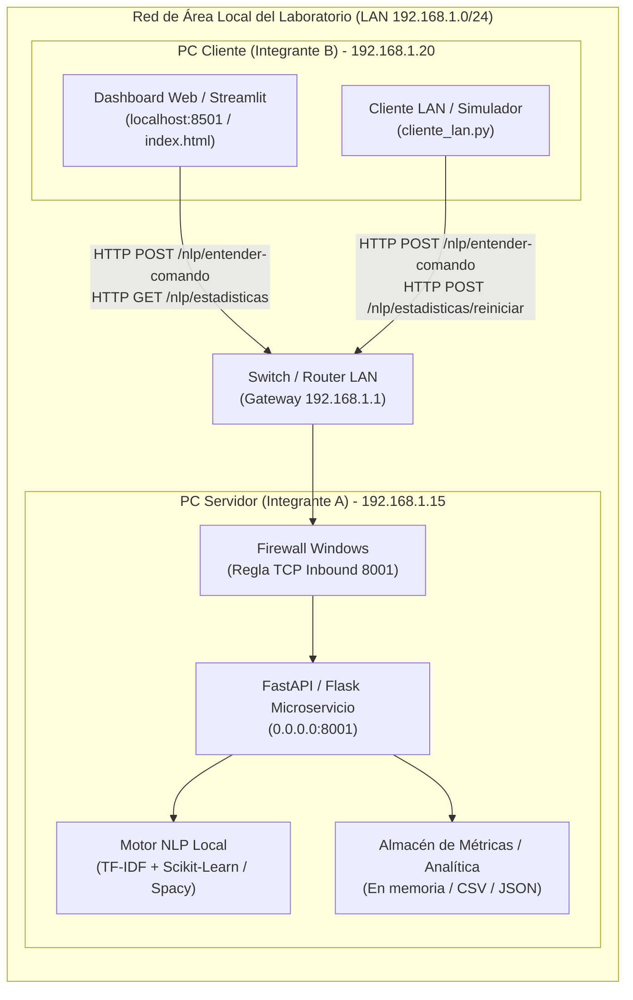
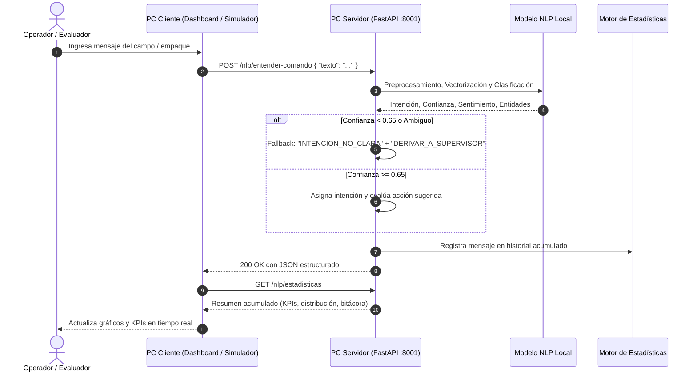

# Ficha Técnica y de Arquitectura: Mini-Azure LUIS Local
**Empresa:** Agroexportadora de la Región de Ica (Uva de mesa y Espárragos)  
**Microservicio:** Clasificación de Reclamos, Extracción de Intenciones y Analítica Operativa con NLP  
**Rol Documentado:** Integrante B (Cliente LAN, Simulador y Dashboard) & Integrante A (Servidor API)  

---

## 1. Topología Esquemática de Red y Arquitectura del Sistema

El sistema opera en la red de área local (LAN) física o inalámbrica del laboratorio sin requerir salida a Internet ni consumo de nubes externas. La PC Servidor expone la API REST en el puerto `8001` y la PC Cliente aloja el Dashboard en tiempo real y el Simulador de peticiones.

### 1.1 Diagrama de Topología de Red LAN



### 1.2 Flujo de Petición y Respuesta HTTP / JSON



---

## 2. Evidencia de Casos de Prueba Evaluados

### 2.1 Caso A: Caso Directo / Claro con Entidades (Reporte de Calidad)
* **Texto Enviado:** `"La camara de frio 2 subio a 9 grados con 120 cajas de uva red globe"`
* **Respuesta JSON (`POST /nlp/entender-comando`):**
```json
{
  "texto_original": "La camara de frio 2 subio a 9 grados con 120 cajas de uva red globe",
  "intencion": "REPORTE_CALIDAD",
  "confianza_intencion": 0.91,
  "sentimiento": "NEGATIVO",
  "entidades": {
    "AREA": "camara de frio 2",
    "PRODUCTO": "uva red globe",
    "CANTIDAD": "120 cajas"
  },
  "accion_sugerida": "ALERTA_CRITICA_CALIDAD"
}
```

### 2.2 Caso B: Con Errores Ortográficos y Jerga de Campo (Robustez NLP)
* **Texto Enviado:** `"urgnt la faja d empaq del paking 1 sta trabada botando javas d esparago vrd"`
* **Respuesta JSON (`POST /nlp/entender-comando`):**
```json
{
  "texto_original": "urgnt la faja d empaq del paking 1 sta trabada botando javas d esparago vrd",
  "intencion": "FALLA_EQUIPO",
  "confianza_intencion": 0.85,
  "sentimiento": "NEGATIVO",
  "entidades": {
    "AREA": "paking 1",
    "PRODUCTO": "esparago vrd"
  },
  "accion_sugerida": "NOTIFICAR_MANTENIMIENTO"
}
```

### 2.3 Caso C: Caso Ambiguo / Confuso (Regla de Fallback a Supervisor)
* **Texto Enviado:** `"hola compa queria avisar que paso una cosa muy rara x aca y no se que decir"`
* **Respuesta JSON (`POST /nlp/entender-comando`):**
```json
{
  "texto_original": "hola compa queria avisar que paso una cosa muy rara x aca y no se que decir",
  "intencion": "INTENCION_NO_CLARA",
  "confianza_intencion": 0.48,
  "sentimiento": "NEUTRAL",
  "entidades": {},
  "accion_sugerida": "DERIVAR_A_SUPERVISOR"
}
```
* **Criterio Técnico Aplicado:** Dado que la confianza estimada es $0.48 < 0.65$ (umbral mínimo del negocio), el clasificador activa la política de incertidumbre obligatoria: asigna la categoría `INTENCION_NO_CLARA` y sugiere la acción preventiva `DERIVAR_A_SUPERVISOR`.

### 2.4 Caso D: Consulta de Inventario
* **Texto Enviado:** `"Cuantos pallets listos de esparrago fresco quedan en el lote L-502 de camara 1?"`
* **Salida del Servidor:** Intención: `CONSULTA_INVENTARIO` (Confianza: 92%), Sentimiento: `NEUTRAL`, Entidades: `{"PRODUCTO": "esparrago fresco", "CODIGO_LOTE": "L-502", "AREA": "camara 1"}`, Acción: `CONSULTAR_SISTEMA_WMS`.

### 2.5 Caso E: Solicitud de Despacho
* **Texto Enviado:** `"Favor de programar salida de camion con guia de remision 004-9821 para contenedor de uva thompson al puerto de Pisco"`
* **Salida del Servidor:** Intención: `SOLICITUD_DESPACHO` (Confianza: 94%), Sentimiento: `NEUTRAL`, Entidades: `{"PRODUCTO": "uva thompson", "CODIGO_LOTE": "004-9821", "AREA": "puerto de Pisco"}`, Acción: `GENERAR_ORDEN_DESPACHO`.

### 2.6 Caso F: Sentimiento Negativo Crítico (Emergencia Operativa)
* **Texto Enviado:** `"PELIGRO fuga de gas amoniaco en el compresor central de sala de maquinas olor insoportable y evacuacion inmediata"`
* **Salida del Servidor:** Intención: `FALLA_EQUIPO` (Confianza: 96%), Sentimiento: `NEGATIVO`, Entidades: `{"AREA": "sala de maquinas"}`, Acción: `EMERGENCIA_PARADA_PLANTA`.

---

## 3. Salida de Analítica Agregada (`GET /nlp/estadisticas`)

Tras la ejecución de la batería de pruebas, el endpoint de analítica consolida las métricas consumidas por el Dashboard en tiempo real:

```json
{
  "total_mensajes": 6,
  "por_intencion": {
    "REPORTE_CALIDAD": 1,
    "FALLA_EQUIPO": 2,
    "CONSULTA_INVENTARIO": 1,
    "SOLICITUD_DESPACHO": 1,
    "INTENCION_NO_CLARA": 1
  },
  "por_sentimiento": {
    "POSITIVO": 0,
    "NEUTRAL": 3,
    "NEGATIVO": 3
  },
  "confianza_promedio": 0.843,
  "tasa_derivacion": 0.167,
  "alertas_criticas": 2,
  "entidades_frecuentes": {
    "AREA: camara de frio 2": 1,
    "PRODUCTO: uva red globe": 1,
    "CANTIDAD: 120 cajas": 1,
    "AREA: paking 1": 1,
    "PRODUCTO: esparago vrd": 1,
    "AREA: camara 1": 1,
    "CODIGO_LOTE: L-502": 1,
    "AREA: puerto de Pisco": 1,
    "PRODUCTO: uva thompson": 1,
    "AREA: sala de maquinas": 1
  }
}
```

---

## 4. Cuadro Comparativo: Despliegue Local (On-Premise) vs. Servicios Administrados en la Nube (Microsoft Azure AI Language / LUIS)

| Criterio Técnico | Despliegue Local On-Premise (Mini-Azure LUIS en LAN) | Servicio en la Nube Pública (Azure AI Language / LUIS) |
| :--- | :--- | :--- |
| **Ventaja 1: Costos Operativos Predictibles (Cero Costo Marginal)** | No incurre en costos por transacción ni pago por millón de caracteres. Es ideal para alta volumetría en plantas agroindustriales con márgenes ajustados. | Costo mensual variable basado en consumo ($ por cada 1,000 llamadas a la API de Text Analytics/LUIS), lo que puede elevar la factura si se envían miles de lecturas operativas continuas. |
| **Ventaja 2: Ultra Baja Latencia y Autonomía Operativa (Sin Internet)** | Latencia de respuesta en LAN $< 25$ ms. No depende del enlace satelital o fibra óptica rural de los valles de Ica; si la conexión externa cae, la planta sigue operando. | Depende de la estabilidad del enlace de Internet hacia la región de Azure (ej. East US / Brazil South). La latencia oscila entre $120$ ms y $> 400$ ms, con riesgo de caída operativa si falla el ISP. |
| **Ventaja 3: Privacidad y Soberanía Total de Datos Operativos** | Los datos de rendimiento de empaque, lotes de uva/espárrago, clientes de exportación y fallas no salen de la red perimetral del fundo, cumpliendo normas de confidencialidad comercial. | La información viaja cifrada hacia centros de datos de terceros. Puede requerir acuerdos de procesamiento de datos (DPA) y cumplimiento de regulaciones sobre residencia de datos. |
| **Desventaja 1: Escalabilidad y Elasticidad de Cómputo** | Limitada a la capacidad de hardware de la PC Servidor local (CPU/RAM). Ante picos masivos simultáneos durante campaña alta de uva, el servidor puede saturarse sin auto-scaling automático. | Escalabilidad horizontal elástica ilimitada administrada por Azure; absorbe miles de peticiones por segundo sin necesidad de aprovisionar infraestructura manual. |
| **Desventaja 2: Mantenimiento y Responsabilidad de Infraestructura** | El equipo de TI local debe encargarse de la alta disponibilidad, respaldos, parches del SO, monitoreo del proceso, seguridad de red y reemplazo de hardware ante fallas. | SLA garantizado del 99.9% respaldado financieramente por Microsoft. Sin necesidad de administrar servidores, parches ni hardware físico (Serverless/Managed). |
| **Desventaja 3: Sofisticación de Modelos Fundacionales y Actualizaciones** | Requiere entrenamiento manual, mantenimiento del dataset de Ica y ajuste de hiperparámetros. El modelo local ligero tiene menor comprensión para frases complejas fuera de vocabulario. | Acceso continuo a modelos de última generación (LLMs/Transformers multilingües pre-entrenados), active learning automático, detección de sesgos y mejoras periódicas sin reentrenar desde cero. |
